# Hexágono: Infinitesimal in the style of Pump It Up Phoenix

**English** | [Português (Brasil)](README.pt-BR.md)

A Project OutFox theme that recreates the screens of **Pump It Up Phoenix** (and Phoenix 2), forked from [Infinitesimal](https://github.com/Team-Infinitesimal/Infinitesimal). The original Infinitesimal follows Pump It Up Infinity. This fork moves it to Phoenix: the title screen, profile select, song select, group wheel, command window and gameplay were rebuilt to work like the arcade, all from the pad.

It was made to run on a Raspberry Pi 5 with a USB pad, locked at 60 FPS.

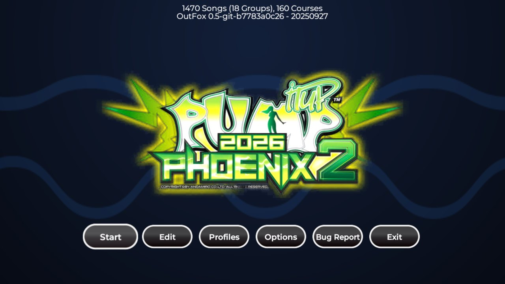

## What changes from Infinitesimal

- **Arcade title screen:** no menu. The center panel joins a player and a second press starts the game; the other side can join before that. With the Phoenix 2 video (local art), the intro plays once and the attract loop repeats with no visible seam. Red left, red right, blue left, blue right, twice, opens the options.
- **Create a profile from the pad:** on profile select, CREATE PROFILE opens an on-screen keyboard. The blue panels pick a key, the center presses it and the red panels erase.
- **Starts on the newest version:** every new game opens song select on a random song of the latest version (currently PHOENIX 2). After a song, song select returns to the song you played.
- **Song select in the Phoenix layout:** a preview strip with the BGA in the middle and mirrored copies on the sides, title with artist and BPM, a wheel of 4:3 jackets with yellow arrows on the selected song, and 13 difficulty balls showing your record score for each chart.
- **Timer in the middle:** the P1 and P2 profile bars sit on both sides of the timer, with level, name and hearts.
- **Transition when a song is chosen:** the wheel slides away, the balls move up and each player gets the MY BEST panel with score, grade and plate, the chart's big ball and the READY stamp. The red panels on READY only take READY back; pressed again, they return to the wheel.
- **Group wheel with Phoenix cards:** game versions, genres (Original, K-Pop, World Music, J-Music, Xross, from each song's genre; Short Cut, Remix and Full Song versions stay in their own groups, as on the arcade), Single (1 to 26), Double (1 to 28) and Half-Double levels, specials and a categories screen, each with its own card.
- **Graphical command window:** opens with the panel code (down-left, down-right, three times), also while choosing the difficulty, and is driven only by the pad. While choosing a category, its name sits between the previous and next ones. It has Speed, Auto Velocity, Display, Note Skin (the skins around the cursor are previewed), Judge (EJ, NJ, HJ, VJ; back to NJ on every new game) and Judge Timing (moves each player's judgment up to 100 ms later or earlier).
- **PIU-style Auto Velocity:** the speed follows the BPM, so gimmicks keep working. Constant speed is still available as an option.
- **Arcade gameplay:** a song is lost only after 40 misses in a row, with Phoenix 2's "HEY! WHY DON'T YOU JUST GET UP AND DANCE MAN?" animation and no score screen afterwards. Emptying the life bar does not end the song but gives a broken (grey) grade. The receptor of the pressed panel glows and every hit shows an explosion, with any noteskin. Notes that a chart marks as hidden (gimmicks) stay invisible.
- **Lists by number of players:** with two players, Double, Half-Double and Co-op are hidden; co-op charts only appear in the Co-op group.
- **BACK and SHIFT arrows in the corners**, from InfiniteWorlds.
- **Sharp wheel thumbnails**, made from each song's background.
- **Static background** instead of the animated video, so browsing stays smooth.

## Screenshots

| | |
|---|---|
| 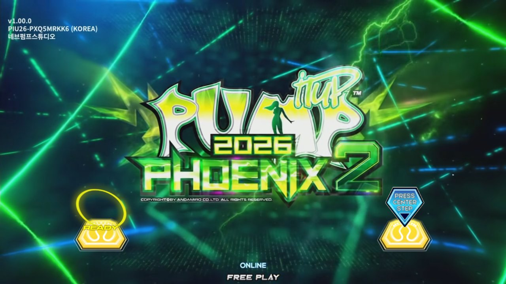 | 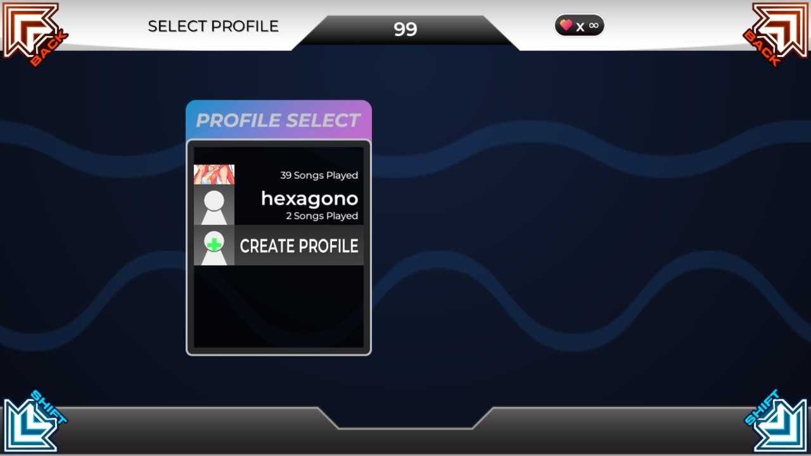 |
| Title screen: player 1 joined; one more center press starts | Profile select with CREATE PROFILE |
| 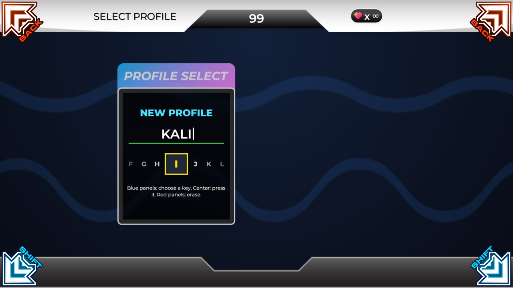 | 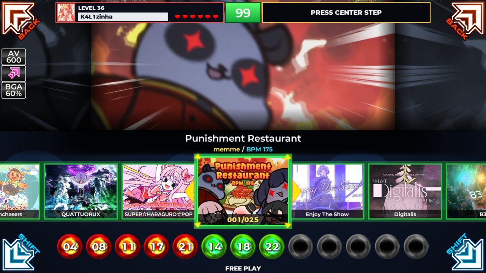 |
| Profile name typed with the pad | Song select, opened on a PHOENIX 2 song |
| 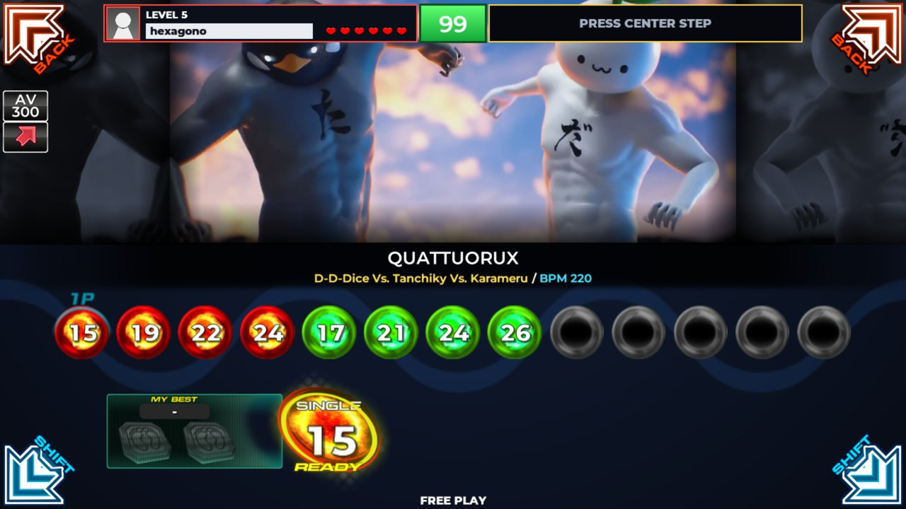 | 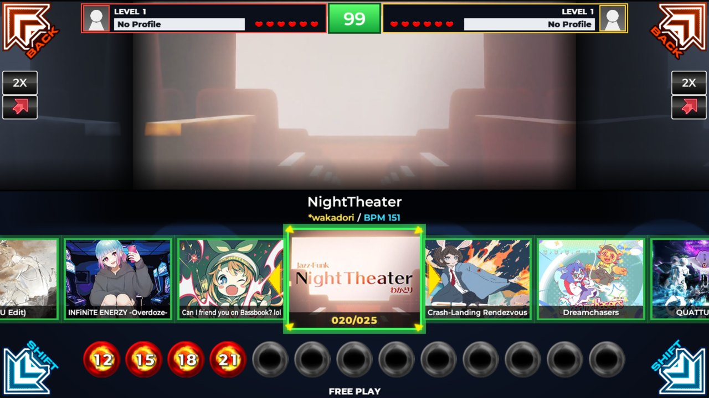 |
| Song chosen: MY BEST, big ball and READY | Two players, timer in the middle |
| 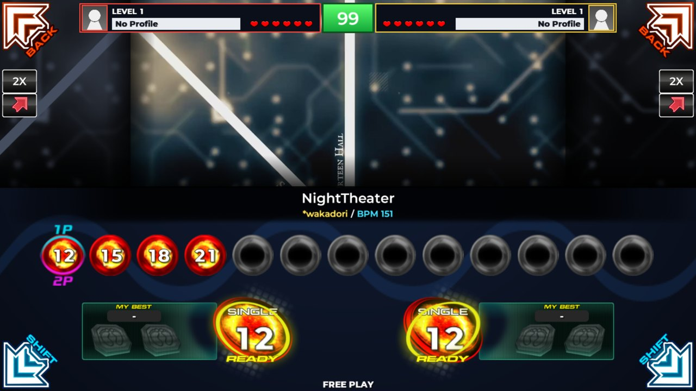 | 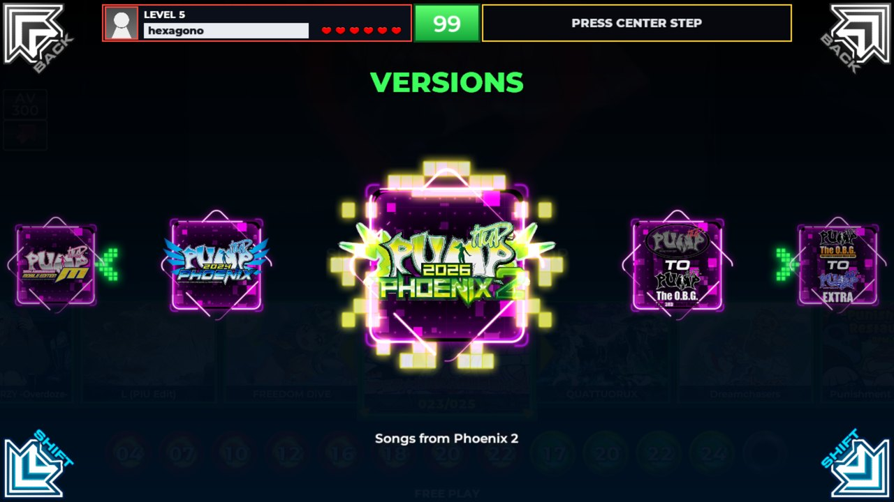 |
| Both players on READY | Group wheel: versions |
| 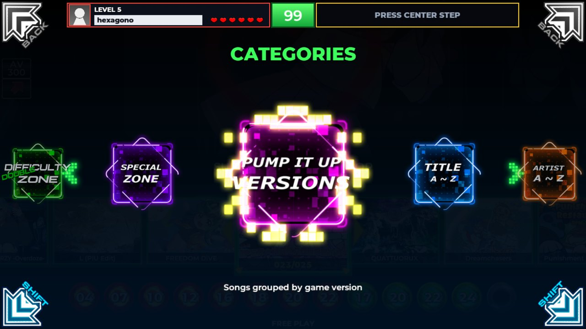 | 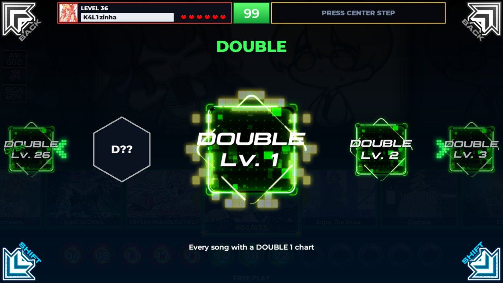 |
| Group wheel: categories | Double levels, 1 to 28 |
| 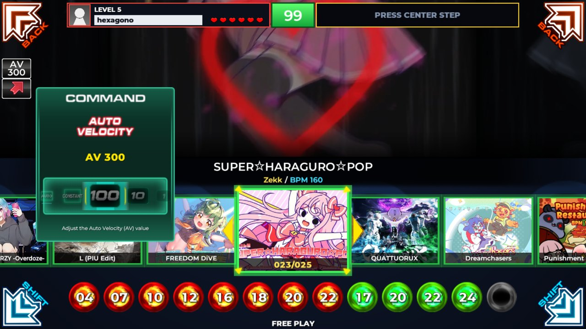 | 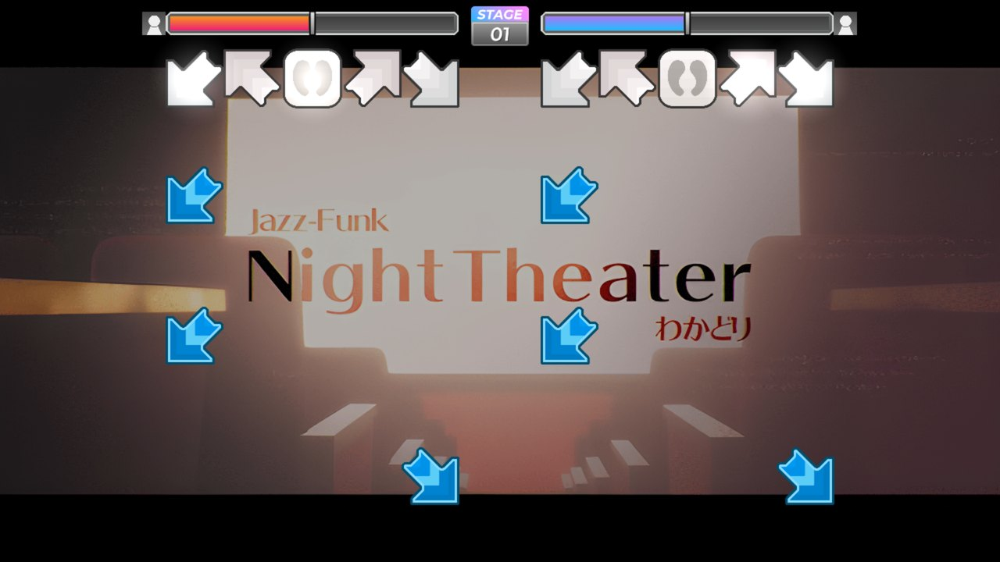 |
| Command window: Auto Velocity | Two-player gameplay: the receptor of the pressed panel glows |

The screenshots show the theme with its art, which `pi/assets.sh` downloads and builds (see [Theme art](#theme-art)).

## Requirements

- [Project OutFox](https://projectoutfox.com/downloads) 0.5.0-pre043 or newer, in `pump` mode.
- Tested on a Raspberry Pi 5 (Raspberry Pi OS, Wayland with Xwayland) at 60 Hz.

## Installation

**On a Raspberry Pi 5**, the [Raspberry Pi kit](pi/README.md) sets up everything from a fresh Raspberry Pi OS: OutFox, this theme with all of its art, 60 Hz on any screen, the game opening at login, the preferences and the pad mapping.

**Elsewhere**, clone the repository into OutFox's [Themes](https://outfox.wiki/user-guide/config/folders/#themes) folder, naming it `Infinitesimal`, pick the theme in OutFox's appearance options and build the art with `bash pi/assets.sh` (written for Linux; it needs Python 3 with Pillow and numpy, ffmpeg and node, and installs the noteskins in `~/.project-outfox/NoteSkins`, or in `$NOTESKINS`):

```bash
git clone https://github.com/kalinathalie/hexagono.git Infinitesimal
```

## Theme art

The Pump It Up and XSanity art belongs to its owners, so the files are **not in this repository**: `pi/assets.sh` downloads them from their sources (phyrebird, YouTube, xsanity.net) and builds the rest with the tools below, into these git-ignored folders. When one is missing, the theme falls back to its own graphics or text:

| Folder | Contents | Without it |
|---|---|---|
| `Graphics/Phoenix/` | channel cards, difficulty balls, big ball, MY BEST panel, READY, cursors, grade icons, arrows, command window, the Phoenix 2 logo and title video, and the stage break animation | XSanity or theme graphics; without the video, the title screen shows the logo |
| `Graphics/XSanity/` | difficulty balls, grade labels, title band, hearts and level cards from XSanity | theme graphics |
| `Graphics/XSCommandWindow/` | the XSanity-style command window | with neither window, the panel code opens OutFox's options list |
| `Thumbs/` | 400x300 wheel thumbnails | banners from OutFox's image cache |

## Tools

- `tools/make_thumbs.py`: builds the wheel thumbnails in `Thumbs/`. Run it on the machine that has the songs, and again after adding songs:

  ```bash
  python3 tools/make_thumbs.py
  ```

- `tools/make_phoenix_cards.py`: builds, from the downloaded Phoenix cards, the cards for Single Lv. 24 to 26, Double Lv. 1 to 4 and 26 to 28, Half-Double and the categories.
- `tools/make_phoenix_logo.py`: cuts the Phoenix 2 logo out of its white background for the title screen.
- `tools/make_phoenix_labels.py`: redraws the command window category labels (SPEED, DISPLAY, NOTE SKIN, AUTO VELOCITY...) at 4x with the theme font, so they stay sharp when enlarged, and adds JUDGE TIMING.

## Inherited from Infinitesimal

The original theme's features still apply: K-Pump style judgment windows and life bar, other timing windows (StepMania, ITG, Infinity, Pro, Jump), the evaluation announcer, Basic Mode, background filters, appearance modifiers and the theme's own options in the operator menu. See the [Infinitesimal README](https://github.com/Team-Infinitesimal/Infinitesimal) for the full list.

## Languages

English, Brazilian Portuguese and Polish.

## Credits

- **Infinitesimal:** dj505, SheepyChris and the whole team listed in `credits.txt`.
- **InfiniteWorlds** by tiny-goat (GPL-3.0): corner arrows and wheel frame.
- **Pump It Up Phoenix and Phoenix 2** by Andamiro: layout reference. Logos and game art belong to Andamiro.
- **XSanity** and **phyrebird**: sources of the optional art used locally.

## License

GPL-3.0, the same as Infinitesimal. See `LICENSE`.
