# Hexágono: Infinitesimal in the style of Pump It Up Phoenix

**English** | [Português (Brasil)](README.pt-BR.md)

A Project OutFox theme that recreates the screens of **Pump It Up Phoenix** (and Phoenix 2), forked from [Infinitesimal](https://github.com/Team-Infinitesimal/Infinitesimal). The original Infinitesimal follows Pump It Up Infinity. This fork moves it to Phoenix: the title screen, profile select, song select, group wheel, command window and gameplay were rebuilt to work like the arcade, all from the pad.

It was made to run on a Raspberry Pi 5 with a USB pad, locked at 60 FPS.

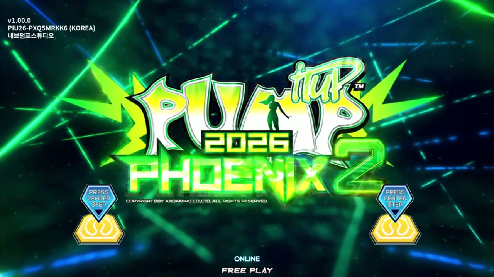

## What changes from Infinitesimal

- **Arcade title screen:** no menu. The center panel joins a player and a second press starts the game; the other side can join before that. With the Phoenix 2 video (local art), the intro plays once and the attract loop repeats with no visible seam; PRESS CENTER STEP appears with the game logo, after the trailer. Red left, red right, blue left, blue right, twice, opens the options.
- **Profiles from the pad:** on profile select, CREATE PROFILE opens an on-screen keyboard: the blue panels pick a key, the center presses it and the red panels erase. Blue left, blue right, three times, edits a profile's name or photo, with OutFox's avatars and the 165 Phoenix player icons (local art). With two players, the red panels drop one, also when the second player joined from song select.
- **Starts on the newest version:** every new game opens song select on a random song of the latest version (currently PHOENIX 2). After a song, song select returns to the song you played.
- **Song select in the Phoenix layout:** a preview strip with the BGA in the middle and mirrored copies on the sides, title with artist and BPM, a wheel of 4:3 jackets with yellow arrows on the selected song, and 13 difficulty balls showing your record score for each chart. The difficulty list wraps around: left on the first chart goes to the last one and right on the last back to the first (Wrap Chart List Scrolling in the theme options, on in the Pi kit).
- **Timer in the middle:** the P1 and P2 profile bars sit on both sides of the timer, with level, name and hearts.
- **Transition when a song is chosen:** the wheel slides away, the balls move up and each player gets the MY BEST panel with score, grade and plate, the chart's big ball and the READY stamp. The red panels on READY only take READY back; pressed again, they return to the wheel.
- **Group wheel with Phoenix cards:** game versions, genres (Original, K-Pop, World Music, J-Music, Xross, from each song's genre; Short Cut, Remix and Full Song versions stay in their own groups, as on the arcade), Single (1 to 26), Double (1 to 28) and Half-Double levels, specials and a categories screen, each with its own card.
- **Graphical command window:** opens with the panel code (down-left, down-right, three times), also while choosing the difficulty, and is driven only by the pad. While choosing a category, its name sits between the previous and next ones. It has Speed, Auto Velocity, Display, Note Skin (the skins around the cursor are previewed), Judge (EJ, NJ, HJ, VJ; back to NJ on every new game) and Judge Timing (moves each player's judgment up to 100 ms later or earlier).
- **PIU-style Auto Velocity:** the speed follows the BPM, so gimmicks keep working. Constant speed is still available as an option.
- **Arcade gameplay:** a song is lost only after 40 misses in a row, with Phoenix 2's "HEY! WHY DON'T YOU JUST GET UP AND DANCE MAN?" animation and no score screen afterwards. Emptying the life bar does not end the song but gives a broken (grey) grade. Broken plays are never saved as records. The receptor of the pressed panel glows with any noteskin (in double, on the pad that was pressed) and every hit shows an explosion, the first note and the one after a miss included (the Pi kit fixes the noteskins that only showed it during a combo). Notes that a chart marks as hidden (gimmicks) stay invisible.
- **Phoenix 2 result screen:** the song's title in a green neon strip, the chart's ball, the judgment table (PERFECT to MAX COMBO and KCAL) counting up, the score with its difference to your record (gold on a first play, green above it, red below), the big grade with its flash and voice, and the plate, over Phoenix's result music. A broken play shows the cracked silver grade and no plate. The pad only leaves the screen once the grade has landed; the timer gives 20 s. The grades are cut from a Phoenix 2 result video and the rest of the art, the voices and the music come from phyrebird (local art); without them the screen uses text.
- **Lists by number of players:** with two players, Double, Half-Double and Co-op are hidden; co-op charts only appear in the Co-op group.
- **BACK and SHIFT arrows in the corners**, from InfiniteWorlds.
- **Sharp wheel thumbnails**, made from each song's background.
- **Static background** instead of the animated video, so browsing stays smooth.

## Screenshots

| | |
|---|---|
| 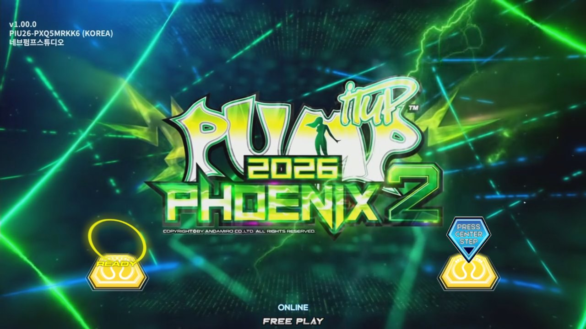 | 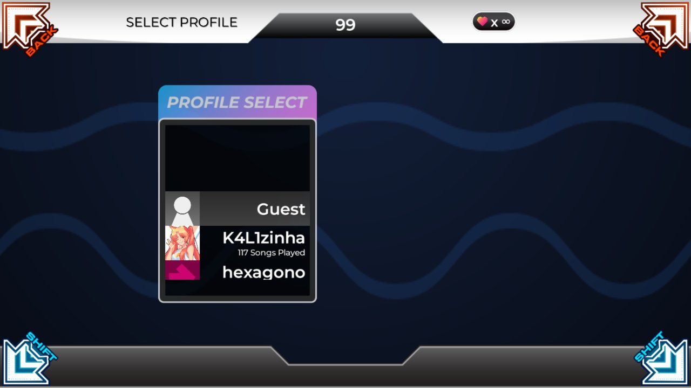 |
| Title screen: player 1 joined; one more center press starts | Profile select with CREATE PROFILE |
| 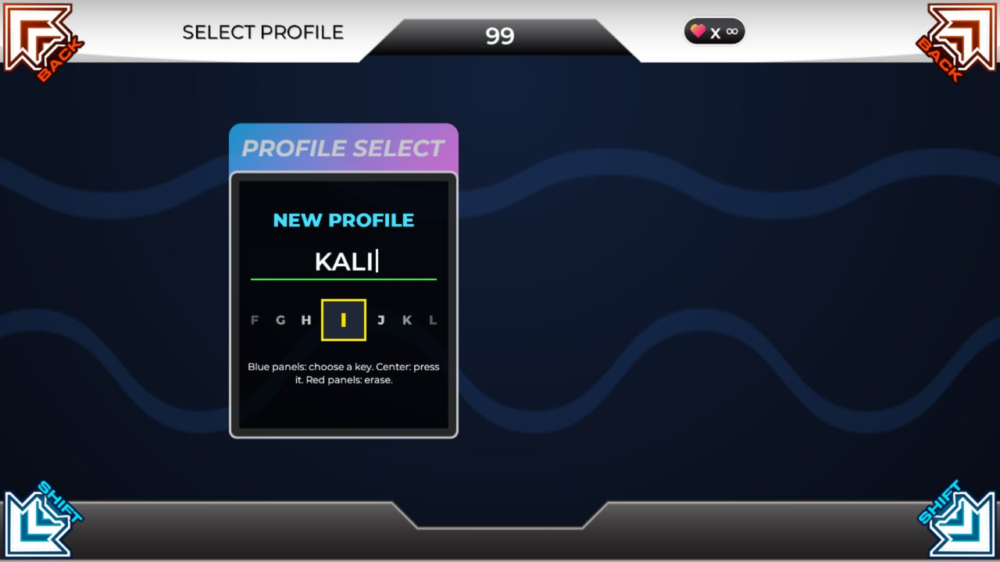 | 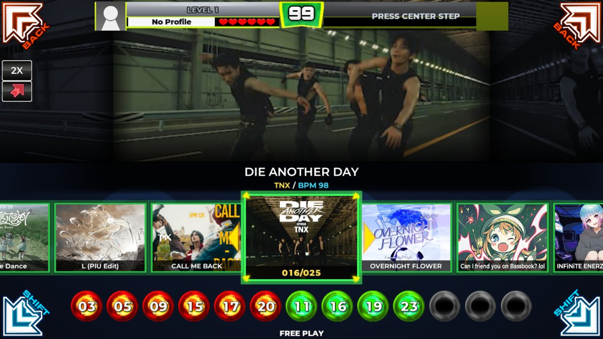 |
| Profile name typed with the pad | Song select, opened on a PHOENIX 2 song |
| 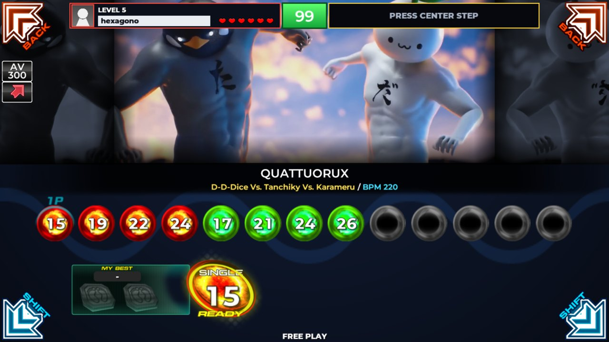 | 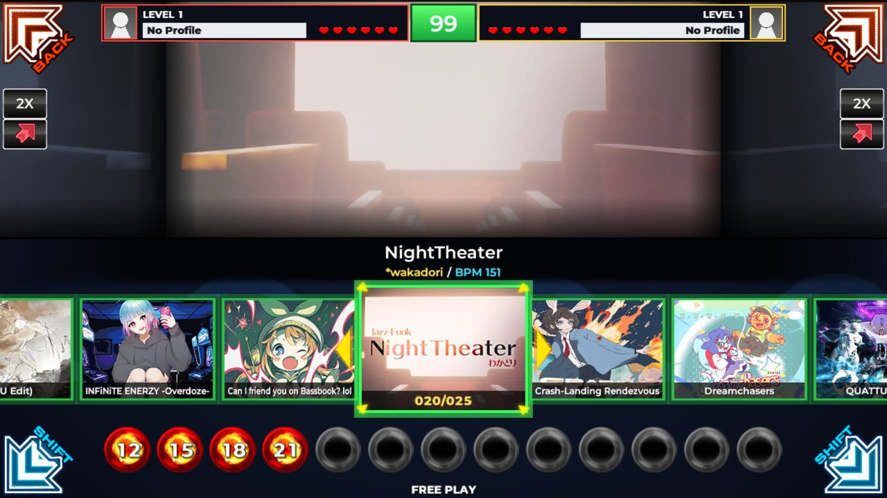 |
| Song chosen: MY BEST, big ball and READY | Two players, timer in the middle |
| 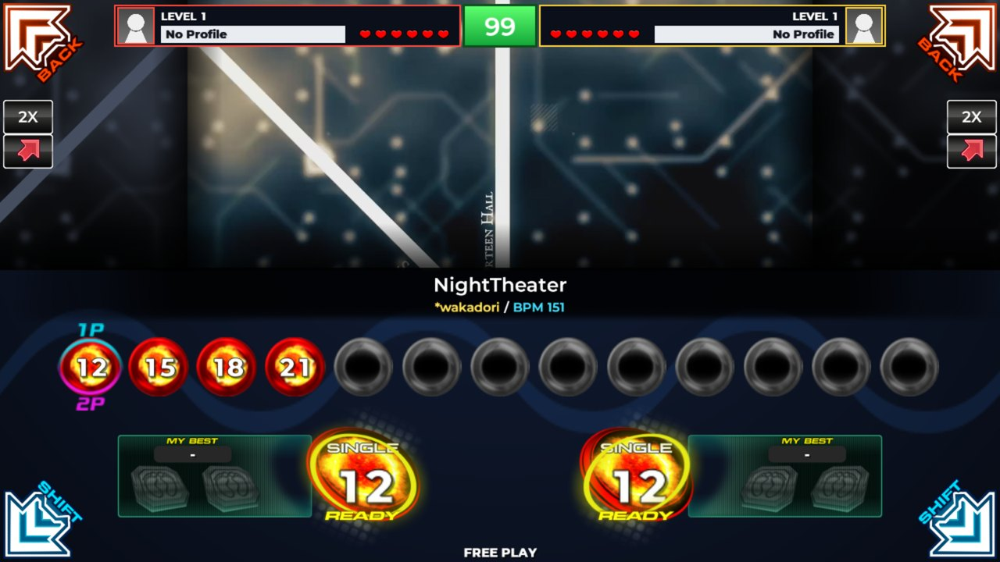 | 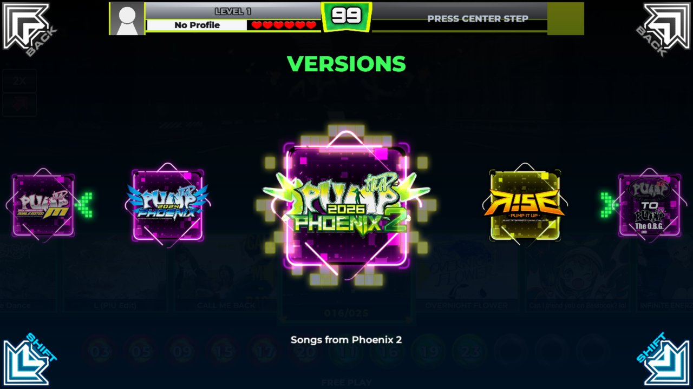 |
| Both players on READY | Group wheel: versions |
| 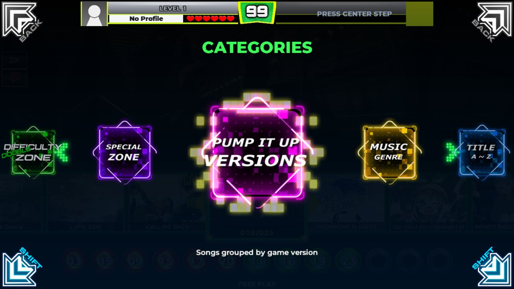 | 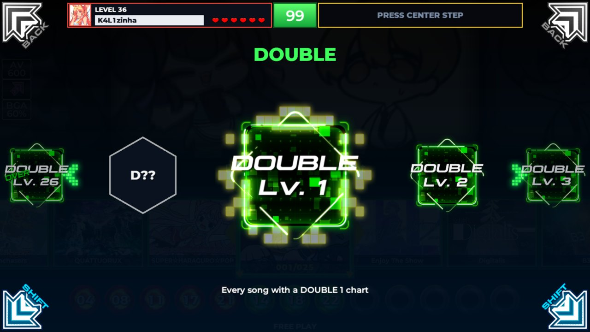 |
| Group wheel: categories | Double levels, 1 to 28 |
| 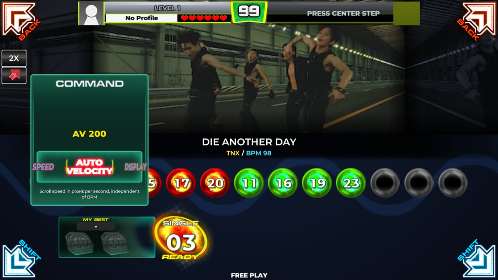 | 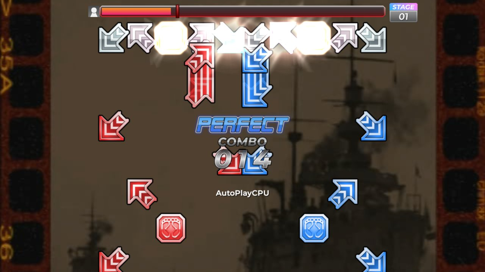 |
| Command window: Auto Velocity | Two-player gameplay: the receptor of the pressed panel glows |

The screenshots show the theme with its art, which `pi/assets.sh` downloads and builds (see [Theme art](#theme-art)).

## Requirements

- [Project OutFox](https://projectoutfox.com/downloads) 0.5.0-pre043 or newer, in `pump` mode.
- Tested on a Raspberry Pi 5 (Raspberry Pi OS, Wayland with Xwayland) at 60 Hz.

## Installation

### On a Raspberry Pi 5

Four steps turn a Raspberry Pi 5 into the reference machine. You need the Pi (the reference has 8 GB), a microSD card with room for the songs (the reference uses 128 GB; its songs take 47 GB), internet, a screen and a pad (a keyboard works too).

1. **Write the system.** In [Raspberry Pi Imager](https://www.raspberrypi.com/software/) choose *Raspberry Pi 5*, then *Raspberry Pi OS (64-bit)*, the version with the desktop, then your card. In the Imager's settings, set a user name, a password and the Wi-Fi. Write the card, put it in the Pi and turn it on.

2. **Install everything** with one command. On the Pi, open the Terminal (its icon is on the top bar), or connect over SSH, and paste:

   ```bash
   git clone https://github.com/kalinathalie/hexagono.git ~/.project-outfox/Themes/Infinitesimal && bash ~/.project-outfox/Themes/Infinitesimal/pi/setup.sh
   ```

   It takes about 20 minutes and installs Project OutFox, this theme with all of its art (title video, cards, noteskins, player icons...), 60 Hz on any screen, the game opening at login, the preferences and the pad mapping. It asks for your password, and midway shows the license of Microsoft's fonts: accept it (choose `<Ok>`, then `<Yes>`, with the arrow keys and Enter) so the cards use the same font as the reference machine.

   It ends with *Done*. If it lists warnings before that, something could not be downloaded: run only the second half again later, `bash ~/.project-outfox/Themes/Infinitesimal/pi/setup.sh`, and it fetches what is missing.

3. **Add the songs.** Copy the song folders to `~/.project-outfox/Songs`, one folder per version, named like `17 - PHOENIX 2` (see [Songs](pi/README.md#songs)). Then build the wheel thumbnails:

   ```bash
   cd ~/.project-outfox/Themes/Infinitesimal && python3 tools/make_thumbs.py
   ```

4. **Restart:**

   ```bash
   sudo reboot
   ```

   The Pi logs in by itself and the game opens on the title screen, at 60 Hz.

The Pi is now like the reference one, except for what is personal (songs, profiles, scores) and its extra noteskins: the reference has 61 from a private collection, a new Pi gets XSanity's 11 and OutFox's 6 ([adding a set of your own](pi/README.md#steps)). If your pad does not respond, map it under INPUT OPTIONS: on the title screen, press red left, red right, blue left, blue right, twice. Every step in detail: [Raspberry Pi kit](pi/README.md).

### On another computer

With [Project OutFox](https://projectoutfox.com/downloads) installed, clone the theme into its [Themes](https://outfox.wiki/user-guide/config/folders/#themes) folder with the name `Infinitesimal`, build the art (see below) and pick the theme in OutFox's options. On Linux:

```bash
git clone https://github.com/kalinathalie/hexagono.git ~/.project-outfox/Themes/Infinitesimal
```

## Theme art

The art of Pump It Up, phyrebird and XSanity is **not in this repository**. One command downloads it from its sources and builds the rest into the theme's git-ignored folders. On the Raspberry Pi, `setup.sh` already runs it; by hand (on Linux, with Python 3, Pillow, numpy, ffmpeg and node):

```bash
bash ~/.project-outfox/Themes/Infinitesimal/pi/assets.sh
```

Most of its time goes to the downloads and the title video. It skips what is already there and ends with a list of anything it could not get, so running it again finishes the job. What it creates:

- `Graphics/Phoenix/`: Phoenix channel cards, difficulty balls, MY BEST, READY, grade icons, command window, Phoenix 2 logo, title video, stage break animation and the player icons.
- `Graphics/XSanity/` and `Graphics/XSCommandWindow/`: XSanity's art, and its Pump noteskins in `~/.project-outfox/NoteSkins`.
- `Thumbs/`: the wheel thumbnails, once the songs are installed.

Anything missing falls back to the theme's own graphics. Sources and options: [the kit's README](pi/README.md#the-themes-art-assetssh).

## Tools

- `tools/make_thumbs.py`: builds the wheel thumbnails in `Thumbs/`. Run it on the machine that has the songs, and again after adding songs:

  ```bash
  python3 tools/make_thumbs.py
  ```

- `tools/make_phoenix_cards.py`: builds, from the downloaded Phoenix cards, the cards for Single Lv. 24 to 26, Double Lv. 1 to 4 and 26 to 28, Half-Double and the categories.
- `tools/make_phoenix_logo.py`: cuts the Phoenix 2 logo out of its white background for the title screen.
- `tools/make_phoenix_labels.py`: redraws the command window category labels (SPEED, DISPLAY, NOTE SKIN, AUTO VELOCITY...) at 4x with the theme font, so they stay sharp when enlarged, and adds JUDGE TIMING.

## Inherited from Infinitesimal

The original theme's features still apply: K-Pump style judgment windows and life bar, other timing windows (StepMania, ITG, Infinity, Pro, Jump), Basic Mode, background filters, appearance modifiers and the theme's own options in the operator menu. See the [Infinitesimal README](https://github.com/Team-Infinitesimal/Infinitesimal) for the full list.

## Languages

English, Brazilian Portuguese and Polish.

## Credits

- **Infinitesimal:** dj505, SheepyChris and the whole team listed in `credits.txt`.
- **InfiniteWorlds** by tiny-goat (GPL-3.0): corner arrows and wheel frame.
- **Pump It Up Phoenix and Phoenix 2** by Andamiro: layout reference. Logos and game art belong to Andamiro.
- **XSanity** and **phyrebird**: sources of the optional art used locally.

## License

GPL-3.0, the same as Infinitesimal. See `LICENSE`.
