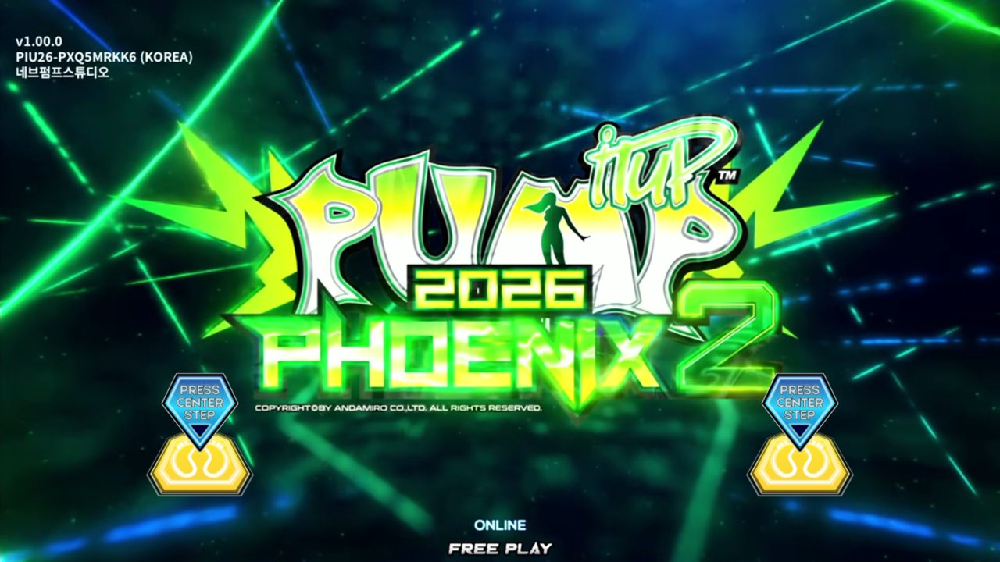
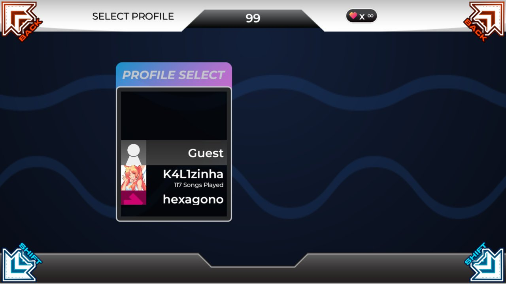
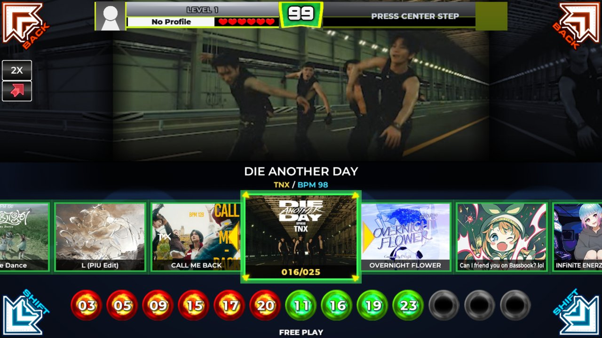
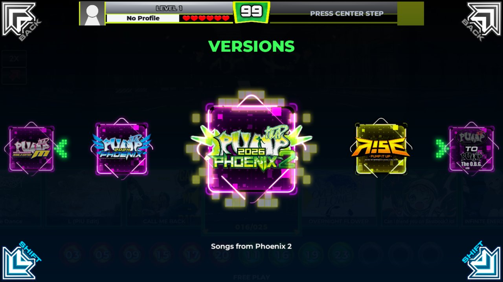
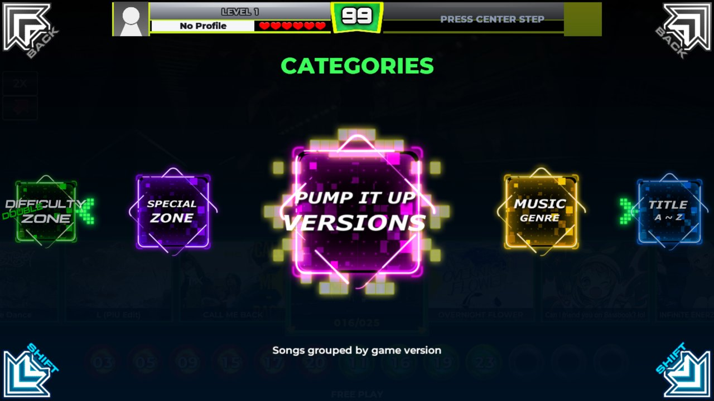
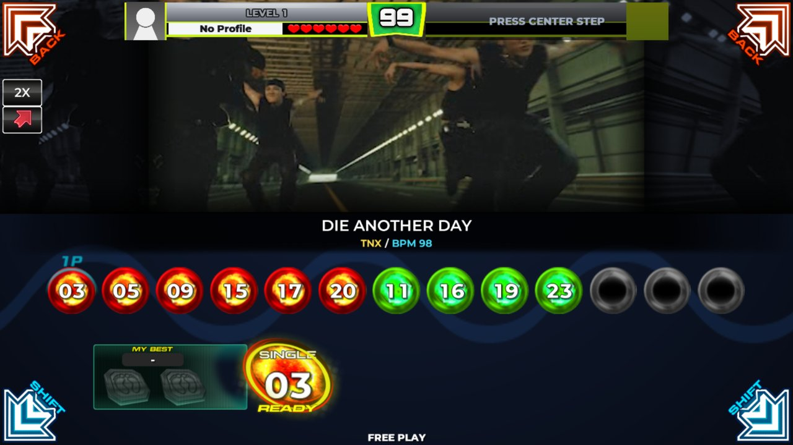
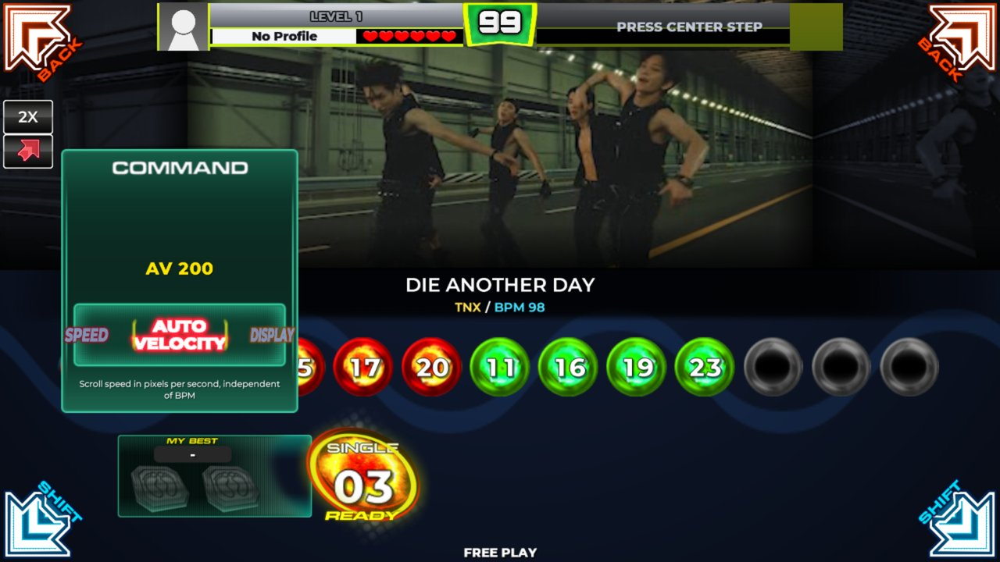
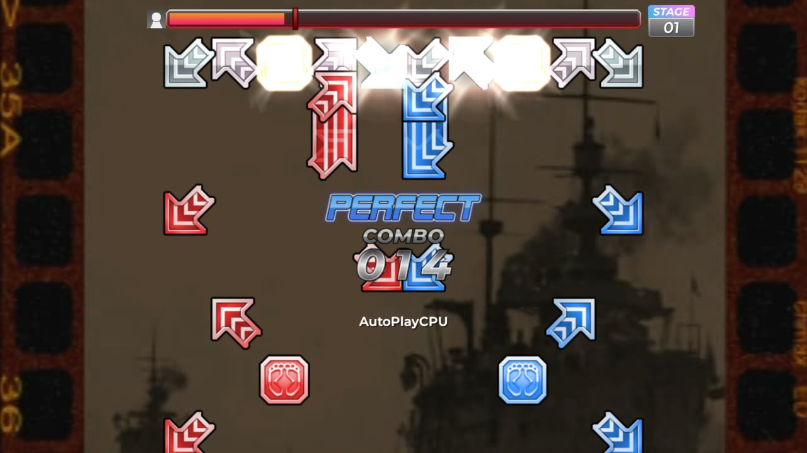
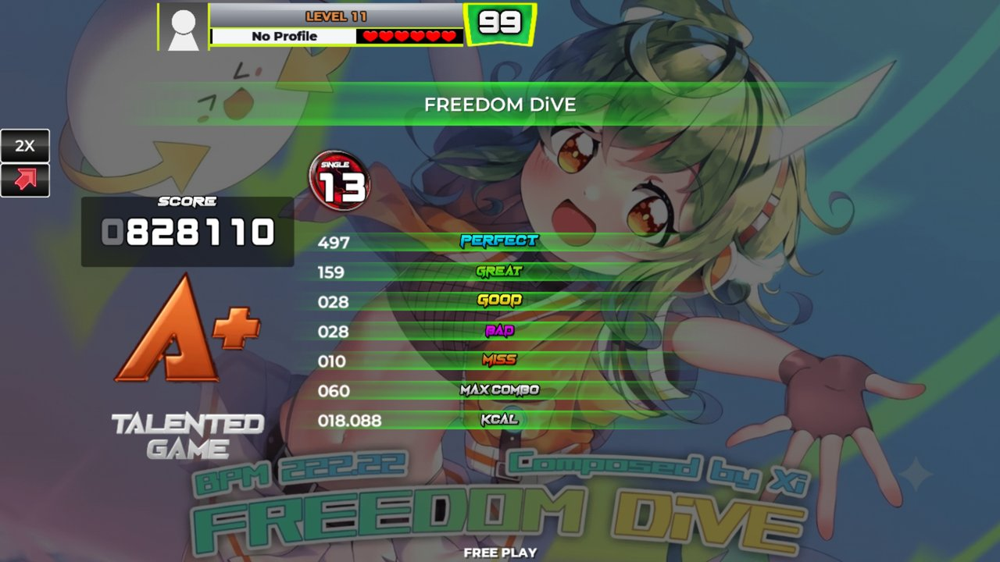

# Hexágono

[English](README.md) | **Português (Brasil)**

Um tema do [Project OutFox](https://projectoutfox.com) que joga como o **Pump It Up Phoenix 2**, derivado do [Infinitesimal](https://github.com/Team-Infinitesimal/Infinitesimal). Tudo funciona pelo tapete, e ele foi feito para um Raspberry Pi 5 a 60 FPS.



| | |
|---|---|
|  |  |
| Seleção de perfil | Seleção de músicas |
|  |  |
| Roda de grupos: versões | Roda de grupos: categorias |
|  |  |
| Dificuldade escolhida: MY BEST e READY | Janela de comandos |
|  |  |
| Chart co-op: as notas de cada jogador na sua cor | Tela de resultado |

## Instalação

### Raspberry Pi 5

1. Grave o **Raspberry Pi OS (64-bit)** com área de trabalho num cartão microSD pelo [Raspberry Pi Imager](https://www.raspberrypi.com/software/); nas configurações dele, defina usuário, senha e Wi-Fi. Ligue o Pi.
2. Abra o Terminal (ou entre por SSH) e rode:

   ```bash
   git clone https://github.com/kalinathalie/hexagono.git ~/.project-outfox/Themes/Infinitesimal && bash ~/.project-outfox/Themes/Infinitesimal/pi/setup.sh
   ```

   Leva uns 20 minutos: Project OutFox, o tema e as artes dele, 60 Hz em qualquer tela, o jogo abrindo no login e o mapeamento do tapete. Aceite a licença das fontes da Microsoft quando ela aparecer. Se terminar com avisos, rode `bash ~/.project-outfox/Themes/Infinitesimal/pi/setup.sh` de novo depois.
3. Copie as músicas para `~/.project-outfox/Songs`, uma pasta por versão (como `17 - PHOENIX 2`), e gere as miniaturas da roda:

   ```bash
   cd ~/.project-outfox/Themes/Infinitesimal && python3 tools/make_thumbs.py
   ```

4. Reinicie com `sudo reboot`: o jogo abre sozinho na tela inicial.

Cada passo em detalhe: [kit do Raspberry Pi](pi/README.pt-BR.md).

### Outros computadores

Precisa do [Project OutFox](https://projectoutfox.com/downloads) 0.5.0-pre043 ou mais novo, no modo `pump`. Clone o tema na pasta Themes do OutFox com o nome `Infinitesimal`, gere as artes (Linux, com Python 3, Pillow, numpy, ffmpeg e node) e escolha o tema nas opções do OutFox:

```bash
git clone https://github.com/kalinathalie/hexagono.git ~/.project-outfox/Themes/Infinitesimal
bash ~/.project-outfox/Themes/Infinitesimal/pi/assets.sh
```

As artes do Pump It Up, do phyrebird, do XSanity e do scoreboard da LBPIU não estão neste repositório: o `assets.sh` baixa e gera tudo na sua máquina.

## Códigos secretos

↖ ↗ são os painéis vermelhos de cima, ↙ ↘ os azuis de baixo e ● o centro amarelo. Pise com menos de 2 segundos entre os painéis.

| Onde | Painéis | O que faz |
|---|---|---|
| Tela inicial | ↖ ↗ ↙ ↘ ↖ ↗ ↙ ↘ | Opções do operador: mapeamento do tapete, opções do tema, AutoPlay CPU |
| Seleção de perfil | ↙ ↘ ↙ ↘ ↙ ↘ | Edita o nome ou a foto do perfil |
| Seleção de músicas | ↙ ↘ ↙ ↘ ↙ ↘ | Janela de comandos: velocidade, Auto Velocity, display, noteskin, judge (vale também escolhendo a dificuldade) |
| Seleção de músicas do Basic Mode | ↙ ↖ ● ↗ ↘ ↗ ● ↖ ↙ | Passa para a seleção de músicas completa |

## Créditos

Infinitesimal por dj505, SheepyChris e a equipe em `credits.txt`; setas dos cantos e moldura da roda do InfiniteWorlds, de tiny-goat. O Pump It Up e as artes dele são da Andamiro. Licença: GPL-3.0, veja `LICENSE`.
